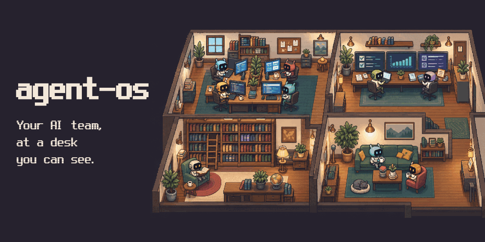
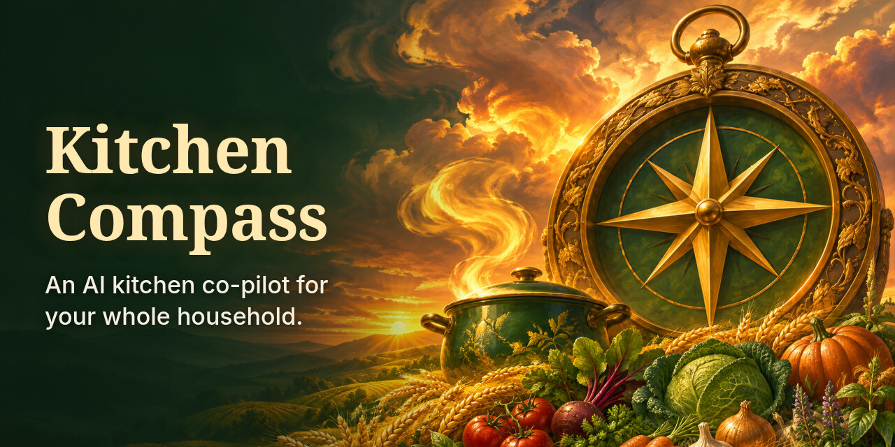
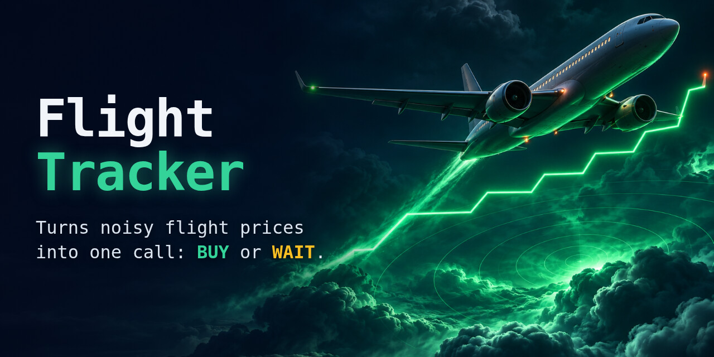

# Ben H <DogmaTheDev>

**Founder, Dogma Labs | Web Developer & Software Engineer**

I build custom websites and web apps for businesses. Based in Bristol, Tennessee.

Dogma Labs: [dogmalabs.tech](https://www.dogmalabs.tech)

## Featured projects

<table>
<tr>
<td width="50%" valign="top">

 <b><a href="https://github.com/DogmaLabsTech/agent-os">agent-os</a></b>
 An office of AI helpers. You talk, they do the work, you decide.
</td>
<td width="50%" valign="top">

 <b><a href="https://github.com/DogmaLabsTech/second-brain">second-brain</a></b>
 Your notes and AI chats, in one searchable brain that stays on your computer.
</td>
</tr>
<tr>
<td width="50%" valign="top">

 <b>kitchen-compass</b>
 An AI kitchen co-pilot for your whole household.
</td>
<td width="50%" valign="top">

 <b>flight-tracker</b>
 Turns noisy flight prices into one call: buy or wait.
</td>
</tr>
</table>

## Stack

TypeScript · Python · Astro · Expo · Supabase
